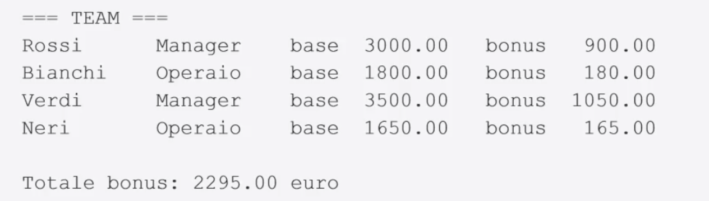

# Esercizio A — il team di dipendenti - 75 minuti

- Una classe astratta Dipendente con nome, stipendio base e un metodo calcolaBonus().
- Due figli: Manager (bonus 30%) e Operaio (bonus 10%), ciascuno con un campo in più: il numero di persone coordinate per il Manager - il numero di ore di straordinario per l'Operaio.

Bonus:
1. Classe Apprendista con bonus 5% e campo aggiuntivo che rappresenta i mesi di formazione svolti.
2. Trovare chi ha il bonus più alto.
3. Stampare solo i Manager + numero di persone coordinate
4. Stampare solo gli Operai + numero di straordinario effettuate
5. Stampare solo gli Apprendisti + numero mesi di formazione svolti
6. Indicare la classe di appartenenza del "Migliore" calcolato sul bonus in precedenza e fornire le info relative
(personeCoordinate x Manager, # mesiFormazione per Apprendista, e # oreStraordinario per Operaio)
7. Ordinare A MANO in ordine decrescente per bonus calcolato

Tutte le operazioni devono essere fatte in una classe apposita